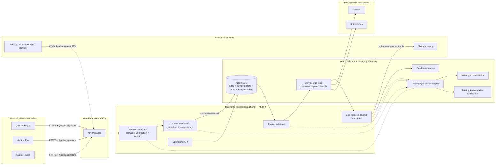

# Premium Payment Notifications — Solution Design

## 1. Solution summary and scope

This proposal receives webhooks from Quetzal Pagos (Mexico), Andina Pay (Colombia), and Austral Pagos (Chile), verifies each provider's signature, maps the payload to a canonical payment event, records the payment in Salesforce, and publishes the canonical event for Finance and Notifications. It also persists processing status so Operations can search by provider identifiers without searching raw logs.

The assessment's scope is retained:

- Part A designs for all three providers. Part B implements intake only for Quetzal and Andina, through publication of the canonical event; Salesforce writing is out of scope for Part B.
- Finance and Notifications are consumers; their implementation is out of scope.
- The integration writes payment records only. It never writes policy status; Salesforce automation owns reinstatement and subsequent policy behavior.
- Nothing is deployed and no real external systems are called for the assessment.

### Design decisions at a glance

| Concern | Proposal | Basis / assumption |
|---|---|---|
| Integration runtime | Mule 4 on the enterprise integration platform; provider adapters, shared intake, outbox publisher, Salesforce consumer, and operations API run as Mule applications | Mule 4 is the assessment reference stack and the platform can run Mule 4 applications. No separate Azure application compute is introduced in this proposal. See ADR-0002. |
| Durable intake and state | Azure SQL Database with inbox, current payment state, processing status, and transactional outbox tables | Store is not prescribed. Relational constraints and transactions are selected to support uniqueness, searchable status, and the outbox. |
| Messaging | Azure Service Bus topic for canonical events, with a Salesforce consumer subscription and dead-letter handling | Azure messaging is required by Part C; Service Bus appears in the incident's v1 design. The target topology is a proposal. |
| Salesforce updates | Asynchronous, bulk upsert, maximum 200 records per request, serialized per payment key | Salesforce supports collection upsert up to 200 records/call; payment API budget and availability favor buffering. See ADR-0001. |
| Provider acknowledgment | Return success only after a durable SQL inbox/outbox transaction commits; do not wait for Salesforce | Chosen to meet the provider deadlines and NFR3 while decoupling Salesforce availability. This depends on the SQL durability assumption in `docs/ASSUMPTIONS.md`. |

## 2. Architecture and components

### Component view



**Trust boundaries:** provider requests enter through API Manager; provider HMAC validation occurs in the provider adapter before accepting the notification. Internal APIs exposed through API Manager require IdP tokens. Mule applications run on the existing enterprise integration platform; Azure SQL and Service Bus hold payment state and events. Salesforce is an enterprise system of record. The scenario says one Azure region serves all countries; this proposal keeps the Azure resources in that region. Network rules, private endpoints, and exact API Manager routing configuration are not specified by the assessment and must be finalized in IaC/security review.

### Runtime placement and observability choice

All application processing in this proposal runs in Mule 4 on the enterprise integration platform. Azure hosts managed data and messaging resources (Azure SQL and Service Bus), but no Container Apps, App Service, AKS, or Azure Functions workload is selected. This keeps provider intake and queue consumers in the integration runtime already described by the scenario. IaC must include Azure compute only if a later design moves application workloads into Azure.

For telemetry, reuse the scenario's existing Azure Monitor, Application Insights, and Log Analytics workspace. Instrument Mule flows and Azure resources with a shared correlation ID and country/provider dimensions; keep payer personal data out of traces and logs. The employer context mentions Dynatrace, but the assessment's scenario explicitly identifies the Azure observability services as already present. Therefore this proposal does not introduce or replace them with Dynatrace. If the actual assessment environment mandates Dynatrace, confirm its integration path and ownership before changing this decision.

### Module boundaries and SOLID

- **Single responsibility:** each provider adapter owns its signature format and source-payload mapping; the shared flow owns provider-independent validation, persistence, and dispatch. The Salesforce consumer owns Salesforce-specific record mapping and API calls.
- **Open/closed:** a new provider is added as an adapter and mapping while the shared flow remains unchanged, aligning with NFR9.
- **Dependency inversion:** provider adapters, SQL persistence, Service Bus publishing, and Salesforce access should sit behind Mule flow/connector boundaries. This keeps provider rules independent of downstream implementations. The exact Mule module/interface layout is a code-level implementation choice.
- **Interface segregation:** webhook intake, outbox publication, Salesforce consumption, and operations search are separate capabilities; callers receive only the operations they need.
- **Testability:** provider adapters can be tested against supplied signature vectors and payload examples; broker, store, secrets, and Salesforce integrations can be stubbed as required by Part B.

These are implementation guidelines for the proposed design. The assessment specifically supports provider logic isolation and requires external dependencies to be stubbed in Part B; it does not prescribe an exact class or interface layout.

### Persistence model

Use Azure SQL Database as a proposed relational store. Do not persist raw webhook bodies or payer personal data. Verify signatures against the raw bytes in memory, parse and discard personal fields, then persist only the canonical business fields and provider identifiers needed for deduplication, ordering, Salesforce writing, operational lookup, and replay.

| Table (proposal) | Key fields and purpose |
|---|---|
| `DeliveryAttempt` | Unique `(Provider, ProviderAttemptId)`; provider event/attempt identifiers; received timestamp; country; correlation ID; sanitized signature/validation outcome. Retain every delivered attempt so Operations can search each provider identifier. |
| `WebhookInbox` | Unique `(Provider, BusinessEventKey)`; normalized source event identity; first/last received timestamps; processing status; correlation ID. Deduplicate business events while preserving retry attempts separately. |
| `PaymentState` | Unique `PaymentKey`; provider transaction/payment ID; policy reference; amount/currency; current canonical status; provider state-change time; last applied event key. Maintain the latest known payment state. |
| `Outbox` | Unique canonical event key; payment key; canonical payload; created/published timestamps; publication status and attempt count. Reliably dispatch committed intake. |
| `SalesforceWork` | Payment key; latest state version/time; retry metadata and status. Support asynchronous batching and per-key serialization. |

Proposed indexes: unique `(Provider, ProviderAttemptId)` on delivery attempts; unique `(Provider, BusinessEventKey)` on inbox; unique `PaymentKey` on payment state and Salesforce work; searchable `(Provider, ProviderTransactionId)` and `(Country, ProcessingStatus, ReceivedAt)` on delivery attempts/inbox. Partitioning is not proposed initially because the assessment provides no storage volume/retention evidence to size it. Retain operational identifiers and status for 90 days, then purge or aggregate; this period is a proposal pending privacy/legal approval. Secrets are not stored in these tables. See assumptions A1–A4.

## 3. Canonical event and provider mapping

### Proposed canonical event

The assessment requires one provider-independent event and a versioned JSON Schema. Proposed fields:

| Field | Type | Meaning |
|---|---|---|
| `schemaVersion` | string | Contract version, e.g. `1.0`; additive optional fields are compatible within a major version. |
| `eventId` | string | Deterministic event identity derived from provider and business event identity. |
| `country` | enum | `MX`, `CO`, `CL`. |
| `provider` | enum | `Quetzal`, `Andina`, `Austral`. |
| `providerEventId` | string | Provider event identifier; for Andina this records the attempt `notificacion_id`. |
| `providerTransactionId` | string | Charge/transaction/payment identifier. |
| `paymentKey` | string | Stable identity of one payment lifecycle, proposed as `country:provider:sha256(providerTransactionId)`, sized to fit Salesforce's 80-character field. |
| `policyNumber` | string | Normalized uppercase policy reference (`POL-<country>-<9 digits>`); reject/quarantine if it cannot be resolved to this documented format. |
| `status` | enum | `pending`, `captured`, `failed`, `refunded`. |
| `amount` | decimal string | Original payment amount in major currency units, normalized to two decimal places for Salesforce Currency(16,2). |
| `refundedAmount` | decimal string or null | Amount refunded, when supplied by provider. |
| `currency` | enum | `MXN`, `COP`, `CLP`, uppercase ISO code. |
| `stateChangedAt` | ISO-8601 UTC timestamp | Provider's state-change time. |
| `receivedAt` | ISO-8601 UTC timestamp | Time Meridian accepted the webhook. |
| `correlationId` | string | End-to-end trace key generated by the edge if not supplied; no provider-supplied correlation header is documented. |

No payer name, national ID, email, card data, or payment token is included. Source personal fields are discarded. Quetzal partial refunds map to `status=refunded`; `refundedAmount` preserves partial amount while Salesforce `Status__c` remains `Refunded`. The currency conversion rules are documented by provider unit: Quetzal minor units are divided by 100; Andina major-unit decimal is parsed; Austral CLP integer has no fractional unit. Salesforce Currency(16,2) is the destination field.

### Provider mapping

| Canonical concept | Quetzal | Andina | Austral |
|---|---|---|---|
| `providerEventId` | `id` | `notificacion_id` (attempt ID); business event key uses `transaccion.id` + `estado` | `eventId` |
| `providerTransactionId` | `data.charge.id` | `transaccion.id` | `payment.paymentId` |
| Proposed `paymentKey` | `MX:Quetzal:<sha256(charge.id)>` | `CO:Andina:<sha256(transaccion.id)>` | `CL:Austral:<sha256(payment.paymentId)>` |
| `policyNumber` | `data.charge.reference` | `transaccion.referencia` | `payment.policyNumber` |
| `stateChangedAt` | `data.charge.paid_at` for capture; `refunded_at` for refund; otherwise `created` | `transaccion.fecha_transaccion` | `payment.occurredAt` |
| `status` | `charge.succeeded` → captured; `charge.failed` → failed; `charge.refunded` → refunded | `PENDIENTE` → pending; `APROBADA` → captured; `RECHAZADA` → failed; `REVERSADA` → refunded | `PAYMENT_CONFIRMED` → captured; `PAYMENT_REJECTED` → failed; `PAYMENT_REVERSED` → refunded |
| Amount | `data.charge.amount` / 100; `amount_refunded` / 100 for refunds | Decimal `transaccion.valor` in major units | Integer CLP `payment.amount`, unchanged as major unit |
| Currency | Lowercase source normalized uppercase | `transaccion.moneda` | `payment.currency` |
| Duplicate event identity | `id` | `transaccion.id` + `estado` (not `notificacion_id`) | `eventId` |

**Andina policy reference handling:** API v2.3 may send the reference exactly as entered; normalize to uppercase and validate against the documented Salesforce policy format. The incident includes malformed/short policy references and the changelog explicitly warns merchants to validate/normalize. Do not guess a policy number. Invalid references are held as data errors for correction; do not repeatedly retry a Salesforce 400.

## 4. Flows and behavior

### Intake, durable acceptance, and asynchronous processing

```mermaid
sequenceDiagram
  participant P as Provider
  participant AP as API Manager
  participant M as Mule provider adapter/shared flow
  participant DB as Azure SQL inbox + state + outbox
  participant O as Mule outbox publisher
  participant SB as Service Bus topic
  participant W as Mule Salesforce consumer
  participant SF as Salesforce
  participant D as DLQ / operations

  P->>AP: HTTPS webhook + provider signature
  AP->>M: Route request
  M->>M: Verify signature over exact raw bytes
  alt Invalid signature / timestamp
    M-->>P: 4xx response; no acceptance
  else Valid signature and payload
    M->>DB: Transaction: deduplicate, update state, insert inbox + outbox
    alt Duplicate business event
      DB-->>M: Existing event/status
      M-->>P: Provider-compatible 2xx
    else Durable commit succeeds
      DB-->>M: Commit acknowledged
      M-->>P: Provider-compatible 2xx (accepted)
      O->>DB: Read pending outbox row
      O->>SB: Publish canonical event
      SB->>W: Deliver event
      W->>W: Order by payment key; buffer for batch
      W->>SF: Bulk upsert up to 200 records
      alt Salesforce success
        SF-->>W: Per-record results
        W->>DB: Mark recorded / update status
      else Retryable Salesforce failure
        SF-->>W: 401, lock, 5xx or API limit
        W->>DB: Schedule bounded retry; preserve status
      else Permanent validation failure or exhausted retries
        W->>D: Dead-letter with reason and identifiers
        W->>DB: Mark failed / dead-lettered
      end
    else Durable commit fails
      DB-->>M: Error
      M-->>P: Non-2xx so provider retries
    end
  end
```

The proposed `2xx` point is after the durable SQL commit, not after Salesforce. For Quetzal, Andina, and Austral, return `204` for newly accepted and duplicate valid notifications, within their documented deadlines; invalid signature/payload returns `4xx`. A failed durable commit returns `5xx` so provider retry behavior can recover the request. This is a proposed response policy; exact response codes for invalid payloads are not specified by provider docs.

### Idempotency and ordering

- **Payment identity:** `PaymentKey = country:provider:sha256(providerTransactionId)`, unique in SQL and populated as Salesforce `Payment_Key__c`. This identifies the payment lifecycle and fits the documented 80-character Salesforce field; the unhashed transaction ID remains available in the protected operational store for lookup.
- **Event deduplication:** Quetzal uses `id`; Andina uses `transaccion.id + estado` because `notificacion_id` changes on each retry; Austral uses `eventId`. Enforce a unique provider-event key in `WebhookInbox`.
- **Ordering:** process a single payment key serially. Compare source state-change timestamp against the stored current timestamp; accept only a newer state. For equal timestamps, prefer terminal states in this documented lifecycle ordering: `pending < captured < failed < refunded` is **not safe for all transitions**; therefore equal-timestamp conflicting states are quarantined for review instead of arbitrarily chosen. Do not allow an older event to replace a newer state. `PaymentState` stores the accepted state and last event key.
- **Salesforce application:** queue only the latest accepted state for a payment key; serialize calls for the same key. Replays use the same `Payment_Key__c` upsert key and same state version. Because Salesforce's documented API has no conditional update by timestamp, the worker must enforce per-key serialization before requests.

The payment-key format and equal-timestamp conflict handling are design assumptions in `docs/ASSUMPTIONS.md`; validate against provider support and Salesforce field constraints before production.

### Error handling and replay

| Error | Handling proposal |
|---|---|
| Invalid signature or expired timestamp | Reject with 4xx; do not persist as accepted. Log provider, reason code, correlation ID, and timestamp only; never log body or secret. |
| Invalid schema/policy reference | Persist sanitized failed status for operational lookup; no blind Salesforce retry. Correct source/reference data, then replay the canonical record through the same idempotent path. |
| Duplicate notification | Do not create a second business event or outbox entry; return provider-compatible 2xx after confirming the original durable record exists. |
| SQL unavailable / commit fails | Return 5xx; do not acknowledge. Provider retries according to its documented delivery policy. |
| Service Bus publish failure | Outbox publisher retries with exponential backoff; outbox remains pending and is not deleted until broker acknowledgment. |
| Salesforce 5xx, `UNABLE_TO_LOCK_ROW` | Retry with exponential backoff and jitter; keep work durable. |
| Salesforce 401 | Refresh OAuth token once, then retry; cache tokens for approximately two hours. |
| Salesforce `REQUEST_LIMIT_EXCEEDED` | Pause Salesforce consumption, honor cooldown based on API usage recovery; alert and retain backlog. |
| Salesforce other 400 validation errors | Mark permanent failure, dead-letter with sanitized error code and identifiers; do not retry until data/configuration is corrected. |
| Exhausted retry/time budget | Dead-letter with reason, preserve original canonical event and identifiers, set status `dead-lettered`; operator replays only after cause is fixed. |

Proposed transient retry policy: exponential backoff with jitter, 1 second initial delay, doubling to a 5-minute cap, maximum 12 hours, then DLQ. These values are tunable operational defaults, not supplied facts. Replay is authorized to the operations role, creates a replay attempt linked to the original event, and reuses original provider event/payment keys so deduplication and Salesforce upsert prevent duplicate business records.

### Operations lookup

Provide an internal operations API through API Manager, authenticated with IdP OAuth 2.0 machine/agent identity and role-based authorization. Search keys: provider + provider event ID, provider transaction/payment ID, and correlation ID. Return country, received time, current status, attempt count, sanitized last error code, Salesforce record result, and DLQ/replay state. No raw body, email, payer name, national ID, payment token, or secret is exposed. Search reads the SQL status index; it does not require raw log search. Application traces, metrics, and logs flow to the existing Application Insights, Azure Monitor, and Log Analytics platform services.

## 5. Capacity, operations, and non-functional requirements

### Capacity and Salesforce budget

The assessment gives peak 120,000 notifications/day and bursts of 40/second for 15 minutes. At maximum Salesforce bulk size of 200 records/request:

- Hard upper bound if every peak notification maps to one Salesforce row and is sent as a single-record request: 120,000 API calls/day, or 80% of this integration's 150,000-call budget. This leaves 30,000 calls of integration-budget headroom, before considering the org-wide shared limit.
- At sustained burst rate, 40 notifications/second fills 200 records in 5 seconds. With the proposed 2-second maximum batch linger, the batch would typically contain about 80 events during this burst, so 36,000 notifications (40 × 900) produce approximately 450 calls over 15 minutes, if each notification maps to a distinct row and no retry amplification occurs. At full 200-record batches, the same burst would require 180 calls. Actual request count depends on arrival distribution and duplicate suppression.
- With a 2-second batch linger, queueing time before dispatch is at most 2 seconds under normal processing; the documented collection-upsert p95 is about 4 seconds. This gives a nominal 6-second batch-wait-plus-Salesforce-call estimate, excluding intake, queue, and recovery time, well inside the 5-minute freshness target. This estimate is not an end-to-end SLO guarantee.
- Keep worker concurrency capped at 20 requests, below the documented maximum of 25, and use per-key serialization. Bulk response results are processed per record (`allOrNone=false`).

This is a sizing estimate, not an SLA proof. It assumes a notification represents at most one payment row and that provider retry traffic does not increase the peak beyond 120,000/day; the 3% duplicate rate is not deducted from the hard upper bound. Salesforce availability is only about 97%, so durable queueing is required. To meet 99.5% within one hour through an outage, the worker must drain any backlog at a rate greater than incoming traffic after recovery; the actual recovery-rate target and Azure capacity SKU need load testing and cost sizing in Part C.

### SLI/SLO and alerts

Derive per-country freshness SLOs from NFR2: at least 95% of accepted notifications produce a visible Salesforce payment within 5 minutes; at least 99.5% within 1 hour. Durability SLI: accepted notification count minus unique notifications traceable to recorded, failed, or dead-lettered state; target zero unaccounted accepted notifications, per NFR3. Report separately for MX, CO, and CL.

Proposed alerts: oldest pending outbox > 1 minute; queue age > 3 minutes; DLQ depth > 0; Salesforce API budget > 70% of daily allocation; retry rate > 5% for 5 minutes; accepted-to-recorded freshness burn against 5-minute/1-hour SLO. Page Payments Integration on-call for freshness breach, any DLQ growth, unaccounted accepted event, or API limit rejection. Thresholds/recipients are proposals and should be tuned from production baseline.

### Security, privacy, cost

- Store secrets in Azure Key Vault; access via managed identity and least privilege. No credentials in code/config.
- Encrypt transport with HTTPS/TLS; restrict data access to integration and authorized operations identities. Exact network controls require IaC/security review.
- Do not persist or emit payer PII or raw webhook payloads. Structured logs contain provider/country, safe identifiers, correlation ID, status, timestamps, delivery attempt, and sanitized error code only.
- One Azure region serves all three countries, per scenario. Existing Azure Monitor, Application Insights, and Log Analytics are reused at platform level.
- Azure SQL and Service Bus are selected for durable state and messaging. Tier/SKU and monthly cost require the Part C cost estimate; precise cost is **[Requires Azure pricing validation]**.

### Delivery pipeline alignment

For Part C, CI should run on every pull request and gate merges on Mule build/MUnit tests, API contract validation, code quality, dependency/security scanning, secret scanning, and IaC validation. CD should define dev → test → prod stages with review/approval controls for production and infrastructure changes, and Azure authentication via federated identity rather than stored credentials. The assessment requires the pipeline as code but does not prescribe a CI provider or specific scanner products; select those in the pipeline deliverable and justify each gate. CD stages are defined, not executed.

## 6. Open items requiring validation

These are explicitly proposed and should be validated before production; they are not facts from the supplied documentation:

1. Confirm 90-day metadata retention with each country's privacy/legal requirements.
2. Confirm source timestamp behavior and conflict-resolution policy for equal timestamps with all providers.
3. Confirm that payment transaction IDs are unique within provider and country for the proposed Salesforce key.
4. Validate Azure SQL and Service Bus throughput, availability, network integration, SKU, and monthly cost against the 40/sec burst and outage backlog.
5. Load-test the 200-record batch strategy, 20-request concurrency cap, retry amplification, and Salesforce flow impact.
6. Agree with Salesforce team on API budget alerts and reserved headroom because the org-wide limit is shared.
7. Validate error response codes, policy-reference rejection behavior, and provider retry expectations against provider sandbox contracts.
8. Confirm operational roles and audit requirements for search and replay.
9. Verify that the Mule integration platform can obtain an approved managed/federated identity for Azure SQL and Service Bus. If it cannot, revise runtime placement to meet NFR6; do not introduce stored Azure credentials.

